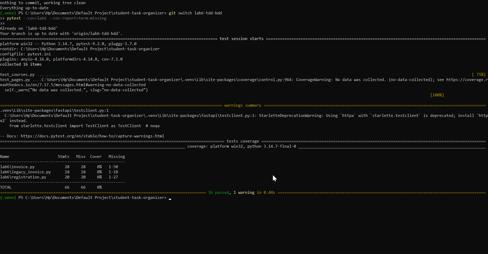

# Task A1 - Coverage



Command, run inside `lab6/`:

```text
python -m pytest --cov=registration --cov-report=term-missing
```

The fifth test, `test_cannot_drop_a_course_that_is_not_registered`, covers line 26,
the error raised when dropping a course that is not registered.

**Does 100% coverage prove the code is correct?** No: it only shows that every line
ran during the tests, not that every input, boundary or business rule was checked
(for example, `register("SET312", -3)` is still accepted although every line is
covered).
